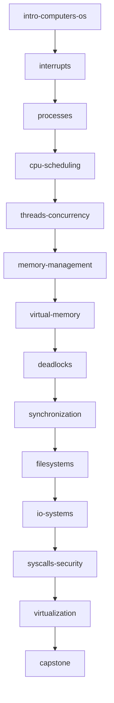

# Curriculum Map

Generated from `src/data/curriculum/config.ts` — the single registry the
roadmap, unlock logic, lesson navigation and progress dashboard all derive
from. A module unlocks when every prerequisite module's assessment is passed
(80% on 10 drawn questions; retakes allowed).

| # | Module id | Title | Prerequisites | Lessons | Simulations |
|---|---|---|---|---|---|
| 0 | `intro-computers-os` | Computers & Operating Systems | — | what-is-a-computer · why-an-os · kernel-user-space · booting | computer-diagram, boot-sequence |
| 1 | `interrupts` | Interrupts, Exceptions & Traps | 0 | why-interrupts · interrupt-lifecycle · polling-vs-interrupts · priorities-masking | interrupt-lab, polling-vs-interrupt |
| 2 | `processes` | Processes & Process Control | 1 | program-vs-process · process-states · fork-exec-wait · zombies-orphans-ipc | process-lab, fork-wait-lab |
| 3 | `cpu-scheduling` | CPU Scheduling | 2 | one-cpu-many-jobs · fcfs-sjf-srtf · round-robin · priority-and-metrics | scheduling-lab |
| 4 | `threads-concurrency` | Threads & Concurrency | 3 | processes-vs-threads · race-conditions · critical-sections-locks · classical-problems-tour | race-condition-lab, bounded-buffer-lab |
| 5 | `memory-management` | Memory Management | 4 | why-manage-memory · contiguous-allocation · fragmentation-compaction · base-limit-protection | memory-allocation-lab, address-translation-lab |
| 6 | `virtual-memory` | Virtual Memory & Paging | 5 | why-virtual-memory · pages-frames-tlb · page-faults-demand-paging · replacement-algorithms · swapping-cow-mmap | paging-lab, page-replacement-lab |
| 7 | `deadlocks` | Deadlocks | 6 | what-is-deadlock · resource-allocation-graphs · bankers-algorithm · detection-recovery | rag-lab, bankers-lab |
| 8 | `synchronization` | Synchronization Deep Dive | 7 | semaphores-mutexes · producer-consumer · readers-writers · dining-philosophers | producer-consumer-lab, readers-writers-lab, dining-philosophers-lab |
| 9 | `filesystems` | Filesystems & Storage | 8 | files-directories · inodes-metadata · allocation-methods · permissions-journaling · disk-scheduling | filesystem-lab, disk-scheduling-lab |
| 10 | `io-systems` | I/O Systems & Device Drivers | 9 | controllers-drivers · pio-interrupt-dma · buffering-caching-spooling · blocking-async-io | io-transfer-lab |
| 11 | `syscalls-security` | System Calls, Protection & Security | 10 | system-calls · protection-isolation · access-control · attacks-defenses | syscall-lab, protection-lab |
| 12 | `virtualization` | Virtualization & Modern OS Concepts | 11 | virtual-machines · containers · multicore-numa · rt-embedded-mobile | virtualization-lab, multiproc-lab |
| 13 | `capstone` | Putting It All Together | 12 | follow-a-program · big-picture | capstone-sim |

Totals: 14 modules · 52 lesson slots · 26 registered simulations · 280+
question-bank items (20 per module; each assessment draws 10).

Related surfaces: the **playground** (`/playground`) exposes every simulation
independently; the **educational terminal** (`/playground/terminal`) drives
the same engines for interrupts, processes, scheduling, memory, paging,
deadlock and files; the **3D entry point** (`/3d`) renders the shared
simulation state as an abstract landscape.
